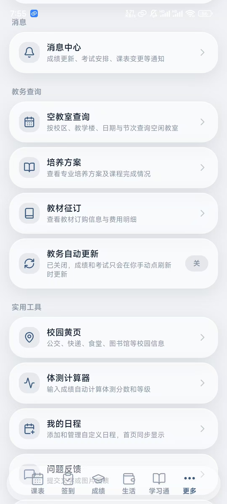
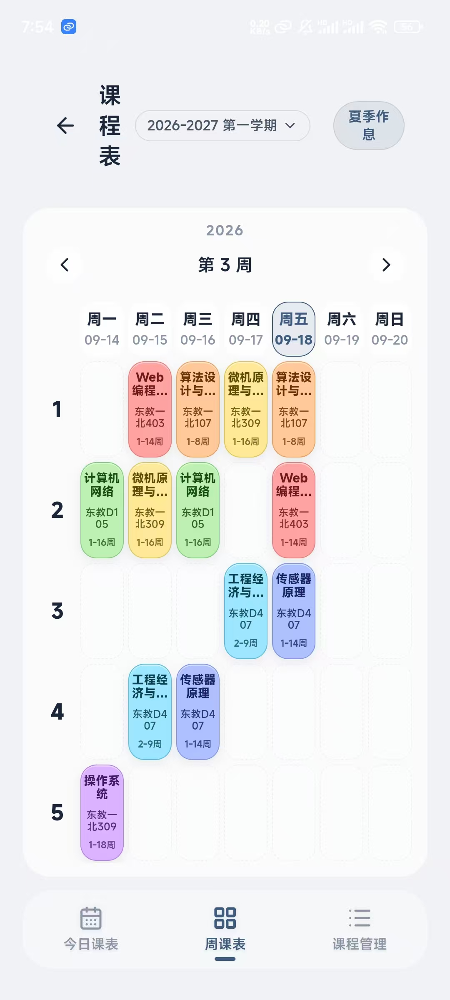
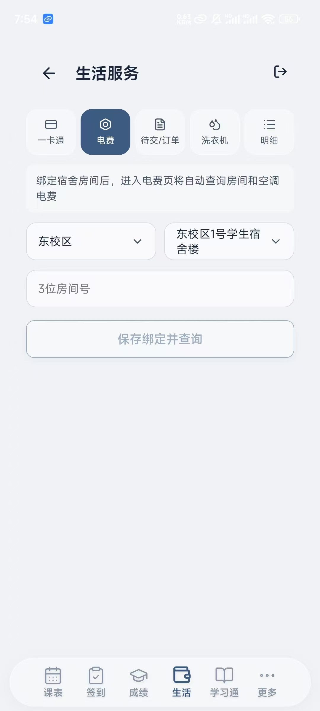
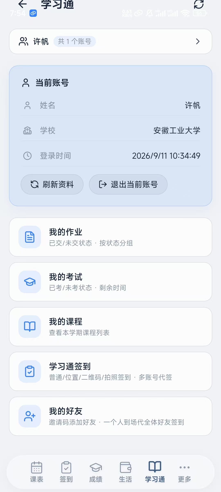
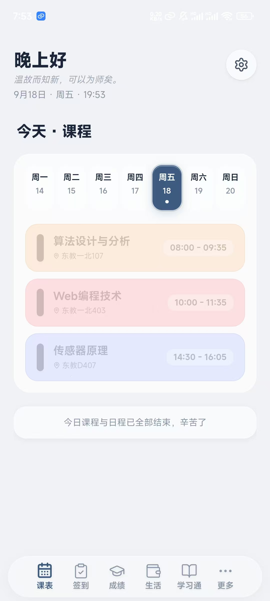
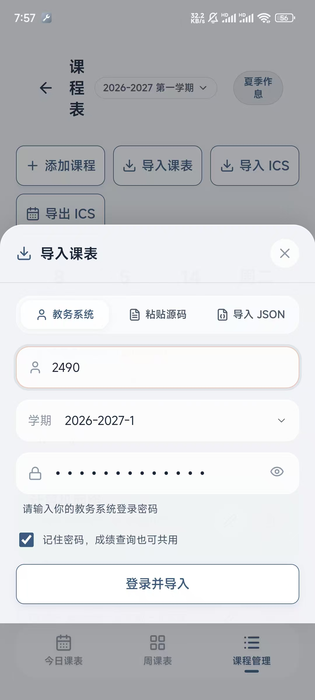

# 氢课表（安徽工业大学）

面向安徽工业大学本科生的轻量课表 App：课表、考试、成绩、签到、宿舍服务一站式。
无开屏广告，界面干净，Android 端安装包小、启动快。

> 🆕 **V1.0.1 已发布**（V1.0.0 Compose 全新架构版的增量更新）
>
> 本版本是**用 Jetpack Compose 从零重写**的独立应用，**应用包名与 2.x 老版本不同**，
> 因此它**不会覆盖安装**老版本 —— 新旧两个可以并存，各用各的。
> 老版本（2.x）仍保留在下方历史 Release 里，按需下载。
> 已装 V1.0.0 的**不用重新下载**：App 每次打开会自动检查更新。

---

## 下载

| 版本 | 架构 | 说明 | 下载 |
|---|---|---|---|
| **V1.0.1**（推荐） | Compose 重写 | 新增无限金币档位 · 一号一邮箱 | **[官网直链](https://xspirt.online/uploads/hydrogen-v1.0.1-code233.apk)** ｜ [GitHub Release](https://github.com/xu20060420fan-cell/AHUT-timetable/releases/download/compose-v1.0.1/hydrogen-schedule-v1.0.1.apk) ｜ [官网介绍页](https://xspirt.online/portal/home) |
| V1.0.0 | Compose 重写 | 功能与体验全面升级 | [GitHub Release](https://github.com/xu20060420fan-cell/AHUT-timetable/releases/download/compose-v1.0.0/hydrogen-schedule-v1.0.0.apk) |
| 2.1.25 | 原生老架构 | 旧版本，已停止功能更新 | [GitHub Release](https://github.com/xu20060420fan-cell/AHUT-timetable/releases/download/v2.1.25/ahut-schedule-release.apk) |

> ℹ️ **国内下载建议走官网直链。** GitHub 的安装包下载走的是 GitHub 自己的 CDN，
> 在大陆线路常常很慢甚至连不上；官网是服务器直连，最快也最稳。

- 下载的是**免安装单文件 APK**，下载后点开即用；首次运行若被系统拦截，点「更多信息 → 仍要运行」。
- App 每次打开会自动检查更新，收到新版本提示按提示更新即可。
- **官网**：<https://xspirt.online> —— 除了下载，官网还提供**晚寝签到**、**学习通签到**等
  **直接在网页上就能用**的在线服务，不装 App 也能用。

---

## 界面预览

| 首页 · 今日课表 | 周课表 | 导入课表 |
|:---:|:---:|:---:|
|  |  |  |

| 学习通 | 生活服务 · 电费 | 更多 |
|:---:|:---:|:---:|
|  |  |  |

---

## 核心功能

1. **账号绑定** —— 输入学号与教务密码完成绑定，自动同步个人课表、考试安排与成绩数据，不用手动录课。
2. **今日课程首页** —— 默认展示当日课程，上完的课程自动置灰，没上的保持亮色，状态一眼可见。
3. **周课表视图** —— 按周查看完整排布，上课时段、地点、授课老师一目了然。
4. **考试信息查询** —— 科目分「未考 / 已考」分类展示，可看每场考试的时间、考场、座位号。
5. **成绩查询** —— 按学期浏览各科成绩、绩点与学分详情。
6. **日常与宿舍签到** —— 晚寝签到、课堂签到都支持；扫码签到、位置签到一并覆盖。
7. **桌面小组件** —— 把课表放桌面；上课后会动态切换成「下课时间」，不用再回 App 看。
8. **课表导入** —— 支持截图导入与文件导入；**导入时以文件自带的作息时间为准**，不用先去手动设置作息。
9. **自定义外观** —— 自定义壁纸、主题色、莫奈取色、课表配色，Dock 透明度可调。
10. **学期设置** —— 在「设置 → 学期设置」里填开学日期与学期周数，课表与小组件才会显示「第几周」。
11. **课表导出** —— 导出 ICS 导入系统日历；可直接「保存到文件」自己选位置，路径清清楚楚。

---

## V1.0.1 更新内容

1. **新增「无限金币」档位**：由管理员按学号或姓名开通后，账号永久拥有无限金币 —— 签到不再涨币，用金币的功能（如代签到等）也不扣分。
2. 无限金币账号不再强制先绑定邮箱，直接就能用需要金币的功能。
3. 签到页金币区会直接显示「无限金币」字样。
4. 服务器后台新增「高级设置」页（邮件通知内容可自定义、金币档位按学号/姓名管理、下载限流配额）。
5. 邮箱改为「一号一邮箱」：换绑会自动解开旧绑定并通知旧邮箱主人；邮箱已被别人占用时会明确拒绝并提示。
6. 服务器加强了下载限流与流量保护。

## V1.0.0 更新内容

1. 桌面小组件（2×2）上课后会显示「下课时间」，不再一直显示上课时间；周课表上课中的格子显示「至 09:40」。
2. 「我的课程」补上课程封面图与学习通账号头像（此前一律显示固定图标）。
3. 新增「设置 → 学期设置」入口：填开学日期与学期周数，课表/小组件才会显示「第几周」。
4. 邮箱绑定改为「发验证码 → 校验 → 才绑定」，不再让别人能占用你的邮箱；首绑 +10 积分的说明只提示一次。
5. 导入课表时以导入文件里的上课时间为准，不用先去手动设置作息。
6. 自定义壁纸后「莫奈取色」重新生效（换壁纸 / 移除壁纸 / 恢复备份后都会重取色）。
7. 导出 ICS 新增「保存 ICS 到文件（自己选位置）」，并写清导入系统日历的三步路径。
8. 学习通 / 考试 / 课表 / 周课表底部补了留白，最后一条内容不再被底栏压住。
9. 实时活动（灵动岛）按 Android 16 官方文档补齐「请求提升 + ongoing event」，此前系统一直不认。
10. 服务器地址改由后台下发，App 启动自动跟随。

---

## 使用手册

### 1. 账号登录

首次打开应用，在登录页输入教务系统**学号和密码**，点击登录即可进入首页。
教务系统会自行校验账号，个人数据只存在你自己的手机上。

### 2. 课表查看

- **今日课表**：打开应用即可看到当天全部课程、上课时间与教室地点。
- **完整周课表**：点底部「课表」页签，左右滑动查看本周与整学期的完整排课。

### 3. 成绩与考试查询

- **成绩查询**：进入成绩页，顶部选择学期，即可浏览各科成绩、绩点与学分详情。
- **考试安排**：在查询页切到「考试」，可确认每场考试的日期、时间段、考场与座位号。

### 4. 日常与宿舍签到

进入签到页，界面会显示当前正在进行的签到任务。
若提示需要签到密码，先输入密码解锁，再点「立即签到」按提示完成操作。

### 5. 检查更新与常见问题

- **版本更新**：软件每次打开会自动检查更新，弹出新版本提示时按提示更新即可。
- **常见问题**：遇到数据加载失败或白屏，先检查网络；仍不正常就彻底退出应用后重开。

---

## 关于

- **官网**：<https://xspirt.online> —— 软件下载、晚寝签到、学习通签到、教程与公告都在这里。
- **在线使用**：不想装 App 也可以，官网的签到服务直接在浏览器里用。
- **GitHub**：<https://github.com/xu20060420fan-cell> —— 本项目及其它开源工具都在这里。
- **QQ**：210864381

---

## 许可

仅供个人学习与本机维护使用。本仓库只发布安装包与说明文档，不包含应用源码。
